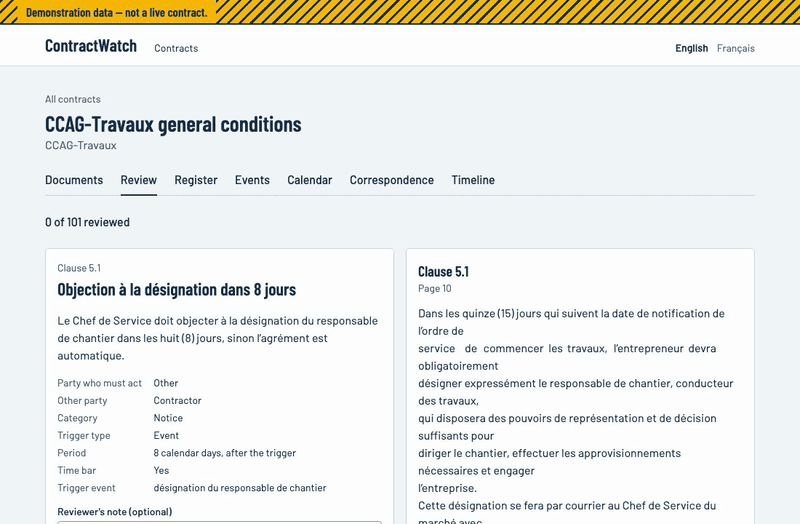
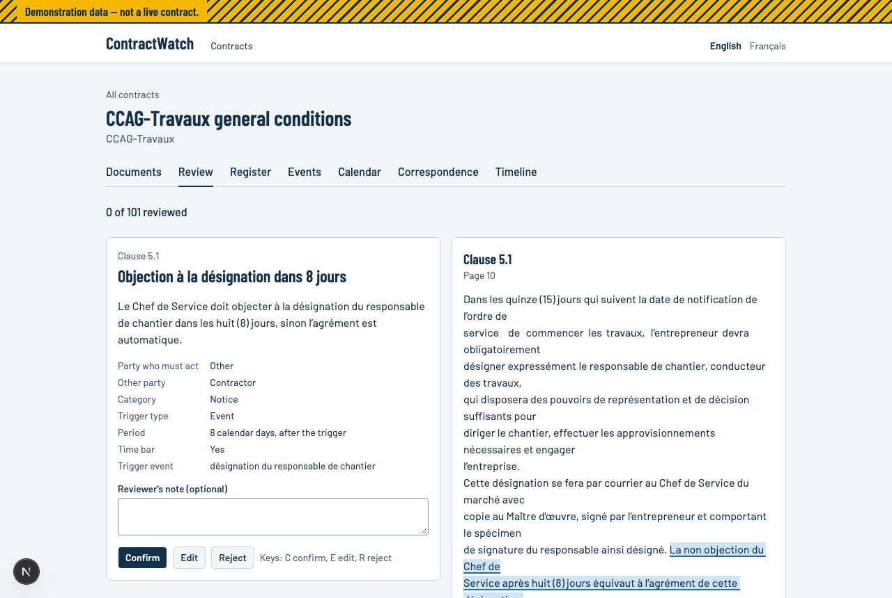
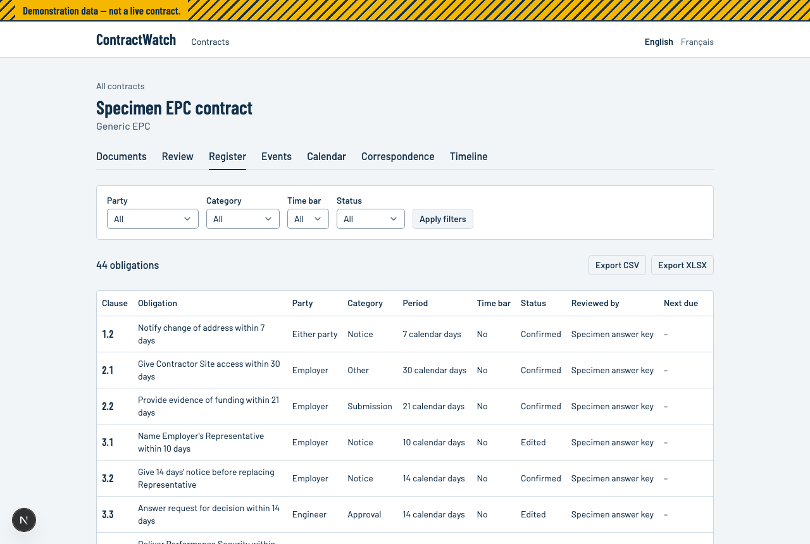
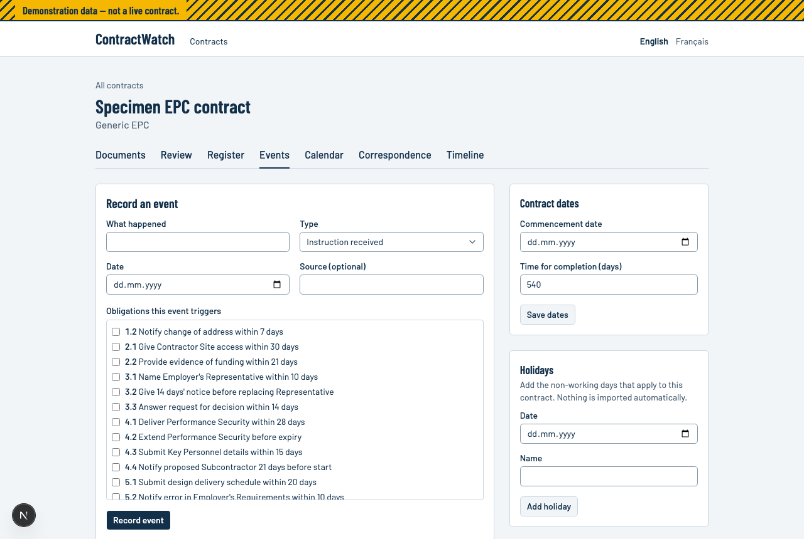
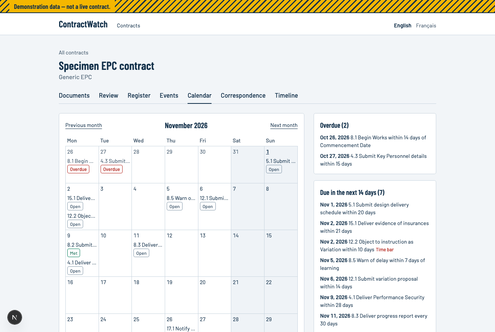
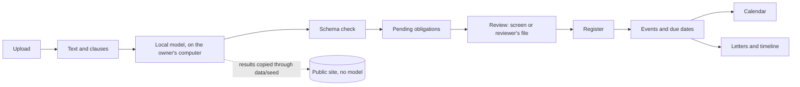

# ContractWatch

[](https://github.com/eacarkan/contractwatch/actions/workflows/ci.yml)

A demonstration tool that reads infrastructure and EPC contracts and turns their time-bound obligations into a reviewed register and notice calendar. It uses demonstration data only and is not deployed on any live contract.

## The problem

Construction and EPC contracts spread their notice periods, time bars and payment deadlines across hundreds of clauses, and a missed notice can lose a right. Those dates are usually tracked by hand, on paper and in email.



## What it does

| Step | What happens |
|---|---|
| Upload | PDF, DOCX or text, in French or English. Scanned PDFs are read in the browser. Text is split into referenced clauses. |
| Extract | A model on your own computer lists each time-bound obligation with its party, period, time-bar flag and word-for-word quote. Every answer passes a schema check before it is saved. |
| Review | Each item appears beside its clause with the quote highlighted, to confirm, edit or reject. An outside reviewer can decide through a file instead. Every change keeps a before-and-after record. |
| Register | Confirmed obligations, filtered by party, category, time bar and status, with CSV and XLSX export. |
| Events and deadlines | Record a dated event and the app works out each due date it triggers, showing the rule beside the date, and recalculates when anything changes. |
| Calendar | A month view, plus lists of what is overdue and what is due in the next 14 and 30 days. |
| Correspondence | Log letters and link them to obligations. An outgoing letter on time marks the deadline met. |
| Timeline | Trigger, due date, notices sent and replies for one obligation, in date order. |

| | |
|---|---|
|  |  |
|  |  |

## Architecture



Next.js, Prisma and Postgres. [docs/ARCHITECTURE.md](docs/ARCHITECTURE.md) has the data model and the deadline rules.

## What the results are

Two demonstration contracts are loaded:

- **Specimen EPC contract:** synthetic, in original wording. All 44 obligations in its answer key are in the register, with 1 extra item rejected. The key was written by Claude along with the contract, and no person has checked it.
- **CCAG-Travaux general conditions:** the published public text, annexe 1. 101 obligations extracted from all 237 clauses. Those a reviewer has decided carry the reviewer's name in the register.

No person has reviewed any of these results. The project owner chose ChatGPT as the reviewer for CCAG-Travaux, and the register says who decided each item.

The measured figures, from `pnpm eval`:

| Set | Recall | Precision | Exact period | Time-bar flag |
|---|---|---|---|---|
| Specimen, 44 items, answer key, strict match | 0.66 | 0.64 | 1.00 | 0.97 |
| CCAG-Travaux, first 30 clauses, 8 items, against ChatGPT's labels | 0.63 | 0.63 | 1.00 | 1.00 |

A strict match needs the same clause, party and category. On the specimen the model found an obligation in every clause the key lists, and most misses are a different category for the same obligation, such as "submission" for "programme". These are small tests. The specimen is simple text with answers from the same author as the contract, and the CCAG-Travaux row measures how often two AI models agree, not accuracy. The plan's targets for recall (0.90) and precision (0.80) were not met.

Models: `orcarouter/Qwen3.8-27B-Uncensored` for the specimen. CCAG-Travaux was extracted by two local models, because the first became unavailable part way: `gpt-oss:20b` for 114 clauses, including the 30 scored, and the Qwen model for the other 123. The Qwen model's quotes were less reliable, with 24 of its 55 items carrying a warning, against 4 of 46.

## How to run

You need Node 24, pnpm 10 and Docker.

```bash
pnpm install
cp .env.example .env
pnpm db:up
pnpm db:migrate
pnpm db:seed
pnpm dev
```

Then open http://localhost:3000. Local development runs offline: Postgres is in Docker, and a gitignored `.local-blob/` folder stands in for Vercel Blob.

To check the code:

```bash
pnpm typecheck
pnpm lint
pnpm test
```

To see how a file splits into clauses without uploading it:

```bash
pnpm split:preview path/to/conditions.pdf --rejected
```

## Extraction

The project is built to cost nothing to run, so extraction uses a model on your own computer or a free tier, through any OpenAI-compatible endpoint. Set `LLM_BASE_URL` and `LLM_MODEL` in `.env`; `.env.example` has examples. A free tier may use what you send it for training, so send it only public or anonymised text.

```bash
pnpm extract <documentId>   # add --delay-ms 7000 for a rate-limited free tier
pnpm eval <documentId>      # prints recall, precision, period match and time-bar accuracy
pnpm snapshot <contractId> <name>   # copies public or synthetic results to data/seed
```

Extraction resumes where it stopped. The public site has no model service set, so visitors see results but cannot start a run. `test/gold/README.md` explains the test sets and who labelled each.

## Review by an outside tool

On the review screen, download the review file, give it to the reviewer, such as ChatGPT, and upload the file it returns. The file holds its own instructions and each clause's text, so use it only for public or anonymised documents. A reviewer cannot change a clause reference or a quote, and a file in the wrong format changes nothing.

## OCR

Scanned PDFs are read inside the app. Upload one and the browser renders each page and reads it with Tesseract (French and English), then sends the text back to be split into clauses. It runs in the browser because Tesseract does not run in Vercel functions. PDFs with no text layer are detected automatically; for a scan with a garbled text layer, tick "Read this PDF with OCR".

Allow several seconds a page, and keep the page open until it finishes. The engine and language data download on first use, from a public CDN, so the first run needs an internet connection.

`scripts/ocr.py` does the same job offline, for example for a long scan, and writes a text file to upload as an OCR text document.

On three pages of a scanned French public procurement circular, the body text read cleanly, while letterheads and stamps were misread (one date lost a digit). OCR text therefore carries a warning on screen and goes through the same human review as any other source.

## Confidentiality

Real contract files never enter this repository. `scripts/anonymise.ts` replaces names and amounts from a private map, shifts every date by a fixed number of days, and refuses to write its output while anything it could not handle remains. The repository contains no FIDIC clause text.

## Limitations

- Extraction needs checking. The figures above are from small tests, and the model does miss and mislabel items.
- An AI reviewer can make the same mistakes as the AI it checks.
- The user chooses which obligations an event triggers. The app does not work this out.
- The roll-forward for a period ending on a non-working day follows CCAG-Travaux art. 38.3 and applies only to that form. Particular conditions could change it, and the app does not check for that.
- Holidays are typed in by hand for each contract.
- The public site has no model service, so visitors cannot extract and link letters by hand.
- OCR can misread stamps, letterheads and dates. A DOCX using Word's automatic numbering should be exported to PDF first, because those numbers are not in its text.
- The demonstration gate is one shared password, not production authentication, and the demonstration contracts reset on each deployment.

## What this does not claim

- It is not deployed on any live contract, and its output is not legal or contractual advice.
- No person has checked these results, and they are not validated on real disputes.
- It does no quantum or delay analysis and drafts no claims.
- It has no licence from or endorsement by FIDIC, and contains no FIDIC text. The specimen contract is original wording.

## Licence

[MIT](LICENSE)
